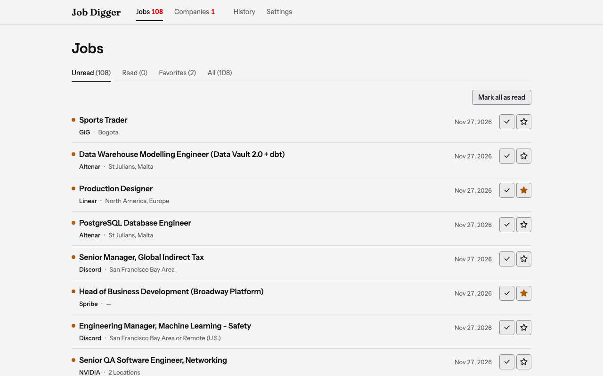
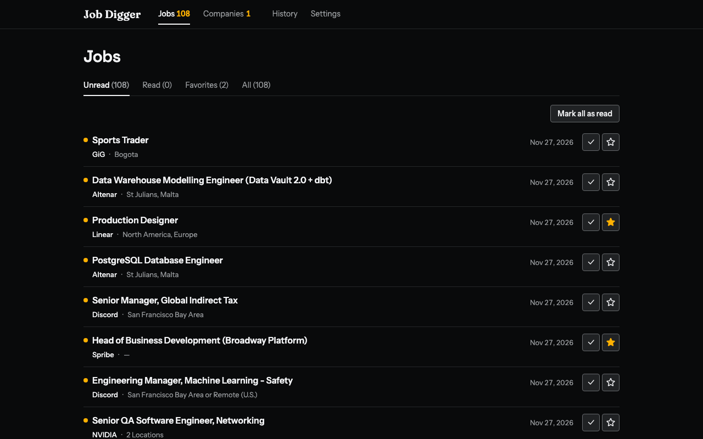
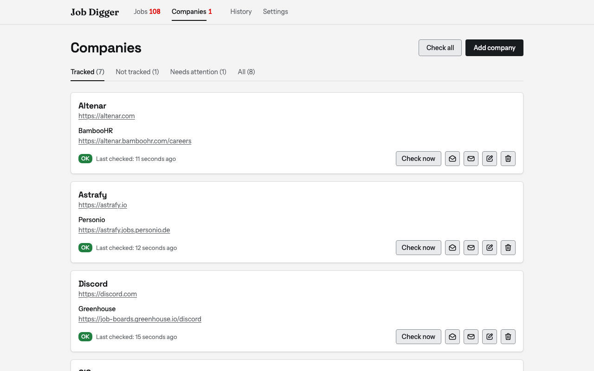
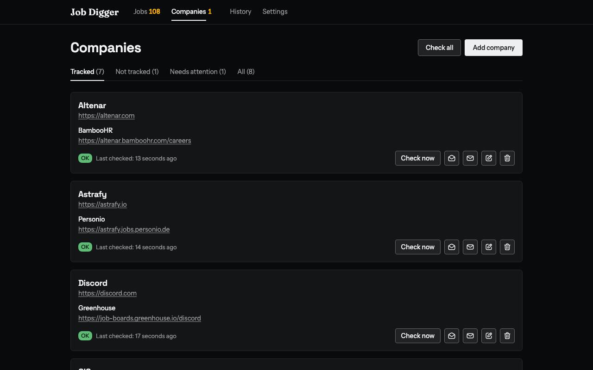
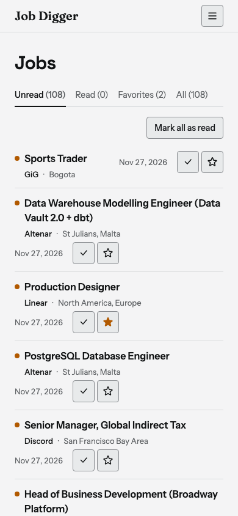

# Job Digger

A personal app that finds the career pages of companies you care about, checks them for
vacancies on a schedule and shows you what is new. It is built for anything from a few
dozen to 300+ companies and runs locally: Next.js, PostgreSQL in Docker, no accounts.



<details>
<summary>More screenshots: dark theme, Companies, phone</summary>






</details>

The screenshots are made from the test fixtures: saved responses of real job boards
served by the local fake web server the E2E tests use.

## What it does

- **Add a company from one address.** Paste a site or a job board link, and the app
  fills in the name, the main site and the career page.
- **Find career pages.** Find pages follows links from the company site to an ATS,
  looks for career pages on the site itself and tries boards with the company's name.
  Every finding is read once before you save it.
- **Read 14 ATS platforms**: Greenhouse, Lever, Ashby, Workday, PeopleForce, Breezy HR,
  CleverStaff, Hurma, Personio, softgarden, Workable, BambooHR, Pinpoint and
  TalentAdore. A company's own career page without an ATS can be read too, once you
  confirm which links on it are vacancies.
- **Check on a schedule.** Scheduled auto-checks (every 3-24 h), Check all, Check now
  and Retry go through one queue in PostgreSQL: at most 5 sources at once, at most 2
  requests at a time to one site, with a 2 s pause, 3 attempts per request and respect
  for `429 Retry-After`.
- **Keep track of vacancies.** Unread, Read, Favorites and All, with Undo. A vacancy that
  disappears from the site is removed, unless it is a favorite: then it stays, marked
  Closed.
- **Spot what needs attention.** Failed sources, pages nothing can read, the history of
  checks.
- **The rest:** CSV import and export, light and dark themes, English and Ukrainian,
  a phone layout, WCAG 2.2 AA checked by axe on every PR.

## Stack

Next.js 16 (App Router, TypeScript) · HeroUI v3 + Tailwind CSS v4 · PostgreSQL 18 +
Drizzle ORM · Cheerio · next-intl · Vitest and Playwright Test · GitHub Actions

The project is ESM (`"type": "module"`). Helper scripts run with plain `node`: Node 26
runs TypeScript without a bundler and reads `.env` through `--env-file`, so there is
neither `tsx` nor `dotenv` among the dependencies. Because of native TypeScript, imports
in such scripts carry the `.ts` extension (`allowImportingTsExtensions` in
`tsconfig.json`).

How the code is laid out - frontend and backend in one Next.js app, split by folder -
is described in [`CLAUDE.md`](CLAUDE.md#repository-layout) and in the README in each
folder of `src/`.

## Running locally

You need Node 26 (see [`.nvmrc`](.nvmrc)) and Docker Desktop.

```bash
git clone https://github.com/Odinokun/job-digger.git
cd job-digger
nvm use                 # Node 26 from .nvmrc
npm ci

cp .env.example .env    # then replace CHANGE_ME with a password of your own (in all four places)
docker compose up -d    # start PostgreSQL in the background
docker compose ps       # wait for the healthy status
npm run db:migrate      # apply the migrations
npm run db:seed         # create the system user
npm run db:seed:demo    # optional: demo companies to click around

npm run dev             # http://127.0.0.1:3000
```

The server listens on `127.0.0.1` only and is not reachable from the network. The demo
companies point at real public career pages, so Check now and Check all on them send
requests to those sites.

Together with the server (`npm run dev` or `npm start`) the background loop of the
check queue starts: [`src/instrumentation.ts`](src/instrumentation.ts), which Next runs
once on server start, launches it. The loop looks into the database every 2 s, so
without a running database the log fills with queue errors. How it works:
[`src/server/queue/README.md`](src/server/queue/README.md#worker-loop). The auto-check
schedule starts there too (`AUTO_CHECK=off` turns it off):
[`src/server/checks/README.md`](src/server/checks/README.md#auto-check).

The author runs a separate clone for daily use, with its own database, backups and
macOS autostart: [WORKING-INSTANCE.md](WORKING-INSTANCE.md).

## Database

PostgreSQL 18 runs locally in a Docker container (the same major version as Neon, where
an online version may go later). The variables, with comments, are in
[`.env.example`](.env.example); `.env` itself never reaches git.

The integration tests use a separate database in the same container - it is created on
the first `npm run test:integration`, only `TEST_DATABASE_URL` in `.env` is needed
([details](src/server/db/testing/README.md)).

How the schema, migrations and seed work: [`src/server/db/README.md`](src/server/db/README.md).
The service is described in [`docker-compose.yml`](docker-compose.yml). The database
listens on `127.0.0.1:5432` and this machine only; if the port is taken by another
PostgreSQL, change it with `POSTGRES_PORT`. The data lives in the Docker volume `pgdata`
and survives re-creating the container.

| Command                      | What it does                                                        |
| ---------------------------- | ------------------------------------------------------------------- |
| `docker compose up -d`       | Start the database in the background                                |
| `docker compose ps`          | Container state: running, `healthy` yet                             |
| `docker compose logs -f db`  | Follow the database log (`Ctrl+C` to leave)                         |
| `docker compose stop`        | Stop the database; the container and the data stay                  |
| `docker compose start`       | Start the stopped database again                                    |
| `docker compose down`        | Stop and remove the container; **the data in the volume stays**     |
| `docker compose down -v`     | The same plus remove the volume: **all local data is gone**         |
| `npm run db:psql`            | Open psql inside the container (`\q` to leave)                      |
| `docker compose exec -T db sh -c 'psql -U "$POSTGRES_USER" -d "$POSTGRES_DB" -c "..."'` | A one-off SQL query without entering psql |

Worth knowing:

- `POSTGRES_USER`, `POSTGRES_PASSWORD` and `POSTGRES_DB` apply **only on the first
  initialisation**, when there is no data volume yet
  ([image documentation](https://github.com/docker-library/docs/blob/master/postgres/README.md)).
  A password changed in `.env` later stays old in the database itself, and connections
  start failing. The only way to apply new credentials is `docker compose down -v` and a
  fresh start, that is losing the local data.
- Without `.env` or without a password in it, `docker compose up` fails at once with a
  message about the required variable - the database never starts with an empty password.
- `npm run db:psql` opens psql interactively but passes no extra arguments: everything
  after `--` goes to `sh`, not to `psql`. For one-off queries, use the full command from
  the table.

## Scripts

| Command                    | What it does                                               |
| -------------------------- | ---------------------------------------------------------- |
| `npm run dev`              | Dev server on `127.0.0.1:3000`                             |
| `npm run build`            | Production build                                           |
| `npm start`                | Run the production build on `127.0.0.1:3000`               |
| `npm test`                 | All tests: unit and integration                            |
| `npm run test:unit`        | Unit tests only (no database)                              |
| `npm run test:integration` | Tests with a real database only                            |
| `npm run test:watch`       | Tests in watch mode while working                          |
| `npm run test:e2e`         | E2E in Playwright: the server starts by itself             |
| `npm run test:e2e:pending` | Only the red scenario of the current stage (`@pending` tag) |
| `npm run test:e2e:ui`      | The same E2E in UI mode - steps, DOM and requests visible  |
| `npm run lint`             | ESLint: Next.js, React, TypeScript and Tailwind rules      |
| `npm run typecheck`        | Next route types + `tsc --noEmit`, without a build         |
| `npm run format`           | Prettier: format the files                                 |
| `npm run format:check`     | Prettier: check only, no changes - for CI                  |
| `npm run db:generate`      | Generate a migration from changes in the Drizzle schema    |
| `npm run db:migrate`       | Apply new migrations to the database                       |
| `npm run db:seed`          | Create the system user (safe to repeat)                    |
| `npm run db:seed:demo`     | Add demo companies for manual testing (local only)         |
| `npm run db:check`         | Check the database connection and show its version         |
| `npm run db:psql`          | psql in the database container (the database must be up)   |

The scripts of the working instance (`app`, `app:update`, `autostart:*`, `db:backup`) are
in [WORKING-INSTANCE.md](WORKING-INSTANCE.md#scripts).

## Tests

Three levels, and **tests never reach real websites**:

- **Unit** (Vitest, `*.test.ts`) - pure logic: parsers, address normalization, the
  vacancy lifecycle, SSRF protection, CSV, the polling schedule.
- **Integration** (Vitest + PostgreSQL, `*.integration.test.ts`) - the queue, conditional
  deletes, concurrent changes, on a separate test database.
- **E2E** (Playwright Test, `e2e/*.spec.ts`) - a handful of key scenarios in Chromium,
  against a production build, a separate database and a fake web server.

Every parser has a real response from its platform saved to a file, and a local fake web
server serves these responses instead of the real sites: the HTTP client sends every
request there in test mode, and SSRF protection lets only that address through. The
saved responses and the address scheme:
[`src/server/http/testing/README.md`](src/server/http/testing/README.md).

Logic is written test-first; `src/readme-coverage.test.ts` also checks that every code
file in `src/` is mentioned in the README next to it.

### E2E tests

Before the first run after cloning, Playwright needs a browser:

```bash
npx playwright install chromium
```

It goes to the system cache (~290 MB), not to the repository. Only Chromium: the app is
personal, cross-browser support is not a goal.

After that `npm run test:e2e` is enough. There is no need to start the app beforehand
or to stop a running `npm run dev`: E2E work next to it.

- **Their own server.** Playwright builds the app (`npm run build`) and starts the
  production build on `127.0.0.1:3001`. Not a dev server, because a second `next dev`
  next to yours does not start: in Next 16 a lockfile keeps two `next dev` from working
  in one project, while `next build` writes to a separate folder. The server on 3001 is
  never reused: if the port is taken, the run fails, because it is unknown which
  database that server works with.
- **Their own database.** The scenarios add and delete companies, so they work with
  `E2E_DATABASE_URL`, not the development database. Before the run `e2e/global-setup.ts`
  creates it if needed, runs the migrations, clears the tables and creates the system
  user. The scenarios run one at a time (`workers: 1`): parallel copies would see each
  other's data.
- **The fake web server** on `127.0.0.1:4010` serves the saved platform responses
  (`src/server/http/testing/serve-fake-web.ts`); Playwright passes `FAKE_WEB_ORIGIN` to
  the app.

The scenarios cover adding, editing and deleting a company, a Greenhouse board turning
into unread vacancies, Check all and its summary, Find pages, CSV there and back, a check
started in another tab, an own page read by a recipe, search, theme switching, the phone
layout and accessibility.

**The red scenario of a stage.** The scenario that defines a stage as done is written at
its start and stays red until the end, so it carries the `@pending` tag.
`playwright.config.ts` has two projects on one browser: `chromium` (run by
`npm run test:e2e` and CI) skips `@pending`, while `pending` (`npm run test:e2e:pending`)
runs only it and shows the step where it fails. Between stages the command ends with
"No tests found". There is deliberately no `--pass-with-no-tests`: with it a forgotten tag
on a new scenario would silently give a green run.

## CI

GitHub Actions runs [`.github/workflows/ci.yml`](.github/workflows/ci.yml) on every pull
request and every push to `main`. A new commit to a branch cancels its previous
unfinished run.

| Job              | What it runs                                                                         |
| ---------------- | ------------------------------------------------------------------------------------ |
| `Lint and types` | `npm run format:check`, `npm run lint`, `npm run typecheck`, `npm audit --audit-level=high` ([why high](#npm-audit)) |
| `Tests`          | `npm run test:unit`, `npm run test:integration`, `npm run test:e2e` (Playwright builds the app itself) |

- **The Node version** comes from [`.nvmrc`](.nvmrc) - one version locally and on CI.
- **Actions are pinned to a full commit SHA**, not a tag like `@v7`: a tag can be moved
  to other code if someone gets access to the action's repository, a SHA cannot be forged
  ([GitHub, secure use](https://docs.github.com/en/actions/reference/security/secure-use)).
  A version comment sits next to the SHA (`# v7.0.1`), and
  [Dependabot](.github/dependabot.yml) updates both once a week with a `ci: ...` PR.
- **The database on CI** is a PostgreSQL service container next to the job, the same
  `postgres:18` image as in [`docker-compose.yml`](docker-compose.yml). The connection
  strings are set right in the workflow: the container lives only for the run and is
  reachable only from its machine, so these credentials do not belong in GitHub
  Secrets. The password is `${{ github.run_id }}`, so the file has no string that looks
  like a real password and would trigger a secret scanner.
- **Playwright browsers are not cached**, as the
  [Playwright documentation](https://playwright.dev/docs/ci) advises: restoring the cache
  takes about as long as downloading.
- **When E2E fail**, the run gets a `playwright-report` artifact - an HTML report with the
  trace of the failed scenario, kept for 7 days.
- **Required checks:** `Lint and types` and `Tests` are the checks to require before
  merging into `main` (a ruleset or branch protection). Third-party checks such as the
  GitGuardian secret scanner are better left optional: they may go red because of a
  branch's history, which squash merge does not bring into `main`.

To reproduce a CI run locally:

```bash
npm run format:check && npm run lint && npm run typecheck && npm audit --audit-level=high
npm test
CI=1 npm run test:e2e
```

## Dependencies

### Dependency install scripts

Some packages run scripts on install: `esbuild` links a platform binary, `@swc/core` and
`@parcel/watcher` pick a prebuilt for the system, `fsevents` has a `binding.gyp`. npm 11
asks to review such scripts, and the approved packages are listed with their versions in
the `allowScripts` field of `package.json` - so `npm install` and `npm ci` pass without
warnings.

The field is advisory for now: the
[npm documentation](https://docs.npmjs.com/cli/v11/commands/npm-approve-scripts) says
plainly that install scripts run even without approval. So the warning never meant
breakage - it meant unreviewed code. When one of these packages updates, or a new one
with its own install script appears, the warning comes back on purpose: new code is
worth a look before it is allowed to run during install.

| Command                             | What it does                                         |
| ----------------------------------- | ---------------------------------------------------- |
| `npm install-scripts ls`            | shows whose install scripts are not reviewed yet     |
| `npm install-scripts approve --all` | approves all and writes the versions to `package.json` |
| `npm install-scripts deny <pkg>`    | explicitly denies a package                          |
| `npm install-scripts prune`         | removes entries for packages no longer in the tree   |

Two places where npm behaves unexpectedly: `--dry-run` on these commands still changes
`package.json` (npm 11.20), and `npm install-scripts ls` sees less than `npm ci` -
`fsevents` shows up only on a fresh install.

### npm audit

CI runs `npm audit --audit-level=high`: a new high or critical vulnerability turns the PR
red, while moderate ones are only visible in the log.

**An accepted risk: esbuild 0.18 in the drizzle-kit chain** -
[GHSA-67mh-4wv8-2f99](https://github.com/advisories/GHSA-67mh-4wv8-2f99), moderate. The
chain: `drizzle-kit` → `@esbuild-kit/esm-loader` → `@esbuild-kit/core-utils` →
`esbuild@0.18.20`. The advisory concerns only esbuild's dev server (the `serve` mode): it
answers with `Access-Control-Allow-Origin: *`, and a third-party site can read the built
files. `@esbuild-kit/core-utils` calls only `transform` and `transformSync` - a one-off
code transformation, no server is started, so we never run the vulnerable code (checked
21.11.2026 on drizzle-kit 0.31.11).

What we do not do:

- `npm audit fix --force` - it would roll drizzle-kit back to 0.18.1, which is worse than
  the problem itself;
- `overrides` to a newer esbuild - there is no gain, and `@esbuild-kit` is written for the
  0.18 API and may break.

Revisit the decision when drizzle-kit drops `@esbuild-kit/esm-loader` (the package is
deprecated in favour of `tsx`, which drizzle-kit already has).

## Accessibility

The goal is [WCAG 2.2](https://www.w3.org/TR/WCAG22/) level AA: all level A and AA criteria
([what the levels mean](https://www.w3.org/WAI/WCAG22/Understanding/conformance)). How it is checked:

- **Automatically on every PR** - `e2e/accessibility.spec.ts`:
  [axe](https://playwright.dev/docs/accessibility-testing) (`@axe-core/playwright`) scans
  every page and the Add company modal in the light and dark themes by the WCAG 2.x A/AA
  tags, plus the `heading-order` rule (headings without skipping a level; a best practice
  in axe). A violation fails E2E.
- **Lighthouse** (26.11.2026, the Accessibility category): 98 on Companies because of
  `heading-order`, no remarks on the other pages. After a hidden `h2` was added above the
  company list, this rule passes in the axe scan too.
- **By hand** - the keyboard (Tab order, visible focus, focus returning from modals and
  menus), reflow at 320 px and 200% zoom, scenarios with VoiceOver. Automation catches
  only part of the problems, so the manual check stays.

Rules for the code and the colour decisions: [src/app/README.md](src/app/README.md#accessibility);
the audit history: [tasks/accessibility-audit.md](tasks/accessibility-audit.md).

## Localization

The UI is in English and Ukrainian; the language is picked in Settings. Translations live
in [`messages/en.json`](messages/en.json) and [`messages/uk.json`](messages/uk.json); their
key sets are the same, which the test [`src/i18n/messages.test.ts`](src/i18n/messages.test.ts)
checks. Language codes are BCP 47 subtags: `uk` is the Ukrainian language (not a country;
the country would be `UA`). Data from websites - vacancy and company names, locations - is
never translated.

The language **does not live in the URL**: next-intl runs without i18n routing, because the
language is a personal setting. The locale is read from the `locale` cookie in
[`src/i18n/request.ts`](src/i18n/request.ts); an unknown value is dropped, and the fallback
is English. The list of languages: [`src/i18n/config.ts`](src/i18n/config.ts).

A consequence of reading a cookie: every page renders on each request (`npm run build`
marks them `ƒ Dynamic`). For an app that shows data from a database this is no loss.

## How it is built

The project is developed in small steps with [Claude Code](https://code.claude.com) as an
AI coding agent, and the author reviews every change:

- **Tasks** live in [`tasks/`](tasks/README.md): one table with every task and its status,
  and a file per task with its description and steps. The work went in stages: the
  foundation, companies, parsing and vacancies, the queue and checks, career page search,
  automation and Settings. Stage 7 - moving to Vercel with Neon and Google sign-in - is
  still ahead.
- **One task is one branch and one pull request.** Commits and PR titles follow
  Conventional Commits; the agent commits step by step and opens the PR, the author
  reviews it, checks it by hand and squash-merges it.
- **Logic is test-first**, and each stage started with a red E2E scenario as its
  definition of done.
- **The rules for the agent** - process, language, tests, security, Git - are in
  [`CLAUDE.md`](CLAUDE.md); hooks and skills are in [`.claude/`](.claude/README.md).

The old task files and early pull requests are in Ukrainian, the author's working
language; everything in the code and the documentation is in English.

## License

The project's code is [MIT](LICENSE). Not under MIT: the agent skills in `.agents/skills/`
(third-party code with its own licenses, details in [.claude/README.md](.claude/README.md#skills))
and the saved website responses in `src/server/http/testing/responses/` (copies of public
pages for tests only,
[src/server/http/testing/README.md](src/server/http/testing/README.md#saved-responses)).

## Documentation

- [Tasks and stages](tasks/README.md) - what is done, what is next.
- [Screens](src/app/README.md#screens-what-they-show-and-what-is-left-out) - what each page
  shows and what it deliberately leaves out.
- [Development rules](CLAUDE.md) - process, language, tests, Git and tasks.
- The README in each folder of `src/` - the details of that part of the code.
